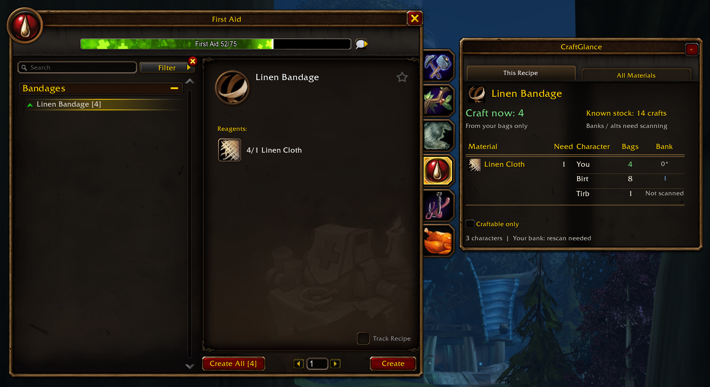
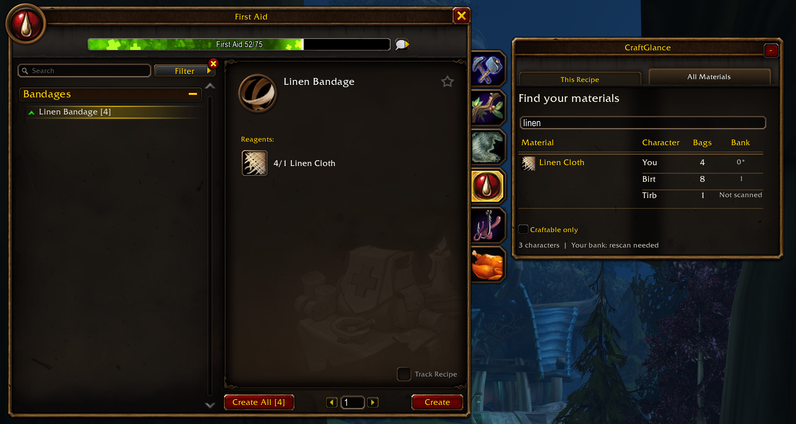
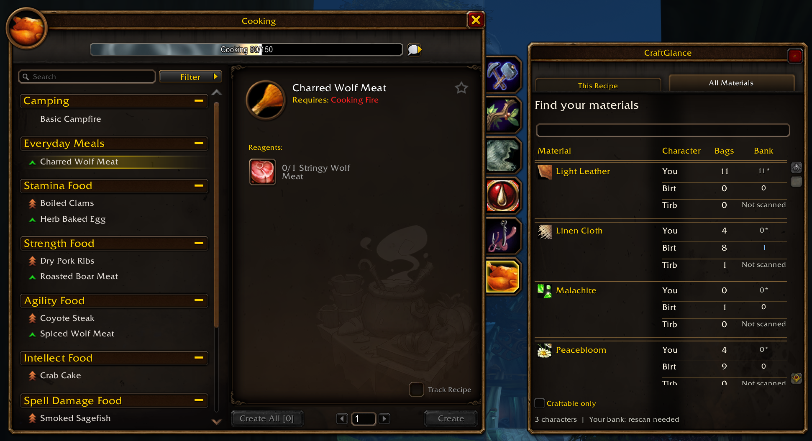

# CraftGlance 0.5.1


A crafting resource tracker for **World of Warcraft Forever**. Select a recipe
in your profession window to see what you can craft now, what is missing, and
which recorded character or bank holds more of the materials.

**0.5.1 is prepared as a Beta upload candidate** on branch `craftglance-0.5.1`.
[CurseForge upload instructions](https://github.com/Birt-tirb/CraftGlance/blob/craftglance-0.5.1/docs/curseforge/upload-settings.md)
and the ready-to-paste description and changelog are included in the repository.
The main branch and published 0.5.0 release remain unchanged.

The earlier 0.5.1 candidate passed live bank transfers, character switches in
both directions, saved alt-bank checks, scanned-zero rows and the final compact
layout. The latest inventory, currency and visible-row fixes passed both Lua
5.1 suites; their live regression check remains separate. See [TESTING.md](TESTING.md)
for the exact scope and remaining checks.

## Screenshots

### This Recipe

Craftable count from current bags, per-craft requirements, and full stock by
character beside the native profession window.



### Find a material

Search recorded Crafting Reagents by name or item ID.



### All Materials

A compact owner table for each reagent, with scrolling when the list is longer
than the attached panel.



The screenshots are supplied in-game captures. Starred bank values such as
**0\*** and **11\*** are last observations marked for rescan and excluded from
Known stock until verified again. **Not scanned** identifies unknown inventory.

## Features

- A collapsible panel, 400 UI units wide, with brown and gold styling matched to
  the profession window, native WoW frame chrome and softer brown tabs with a
  reduced hover glow. It reserves native layout space so the bank opens
  alongside it. The recipe list, Create and Create All controls stay usable.
- **This Recipe** opens by default. Native recipe and reagent icons help you
  recognize the selected craft and its ingredients.
- The prominent **Craft now** count uses items in bags only, including the
  equipped reagent bag. Currency rows show your owned balance and update when
  it changes. **Need** includes any per-reagent cost specified by the recipe.
  **Known stock** is a separate planning count using current
  bags and eligible recorded bags and character banks in your inventory scope.
  Saved stock can change between observations, and unscanned inventories may
  contain more. Required tools, location and cooldowns still apply.
- A shared **Material / Need / Character / Bags / Bank** header keeps the stock
  list compact. Each character appears beside the material on one row, with
  their full bag and bank quantities. **Need** shows the amount for one recipe
  execution. Gold divider lines separate materials and owners. **Not scanned**
  marks unknown inventories. A small **Missing** note appears beneath a material
  when your bags lack enough for one craft. Hover a material for its item tooltip
  and a character for the full name and scan ages.
- Recorded characters with scanned zero holdings remain visible as **0 / 0**.
  Their zero counts stay distinct from **Not scanned** inventories.
- Short lists fit the panel's height. Longer lists grow up to the profession
  window's height limit, with a scrollbar only when the contents overflow.
  The background keeps its header edge aligned beneath the tabs in both views.
  Shorter panels crop the lower background while preserving the native borders.
- Bags are recorded on login and inventory changes. Character banks are scanned
  only while accessible at a bank. Counts, owner names and observation times
  survive logout and UI reload. Unscanned banks are labelled clearly.
- A muted count with **\*** preserves the last observation after a failed scan
  or a bank change that still needs verification. Hover for the age and rescan
  status. Known stock excludes stale banks and stale bags on offline characters.
  An open bank retries when the item data it was waiting for arrives.
- **All Materials** searches recorded items the client identifies as
  **Crafting Reagents**, by name or exact item ID. Each matching reagent shows
  its character, bag and bank quantities in the compact shared table, including
  reagents outside the selected recipe. Entries appear once the client has
  loaded their item information and confirmed the Crafting Reagent flag.
- **Craftable only** uses the client's native recipe-list filter. Its behavior
  follows the game. CraftGlance's separate item count uses bags only.
- If recipe data causes a refresh error, the panel falls back to a readable
  status, keeps its collapse control available and can recover on the next
  normal update. Repeated errors are logged once instead of starting a retry
  loop.

## Install and use

Extract the release ZIP into `World of Warcraft/_forever_/Interface/AddOns/`.
The result should be `AddOns/CraftGlance/CraftGlance_Camelot.toc`, with the Lua
files beside it. Restart WoW after a first install, then enable CraftGlance in
the AddOns menu. Updates can normally be loaded with `/reload`.

Open First Aid or another crafting profession and click a recipe. Use the
title-bar toggle to collapse or expand the panel. It stays attached to the
profession window as the bank opens or closes. `/cg` or `/craftglance` expands
it while the profession window is open.

Visit a bank once on each character to record its contents. Log in on another
character to record its bags; you must use the same WoW account and local
SavedVariables files. The addon cannot inspect an offline character remotely.
Treat saved counts as last observed, especially after moving items on an alt.

## Scope and limitations

Targets Forever interface **16001** and client build **1.60.1.71091**.
Uses the modern `C_TradeSkillUI`, `C_Container`, `C_Item` and
`C_Bank` APIs and purchased character-bank container IDs. It does not use legacy
bank-container numbering or modify the native crafting controls.

Character inventories are kept separate by region, realm identity and faction.
Forever exposes no verified ruleset identifier in this client, so the addon
conservatively limits stock comparisons to the current realm and faction. Guild
and shared account banks are not scanned. Characters that have never logged in
with CraftGlance cannot be listed; the footer prompts you to scan alts.
Inventory scope uses the realm component of a valid Player GUID with region
and faction boundaries. Legacy keys migrate to this stable identity, including
the blank realm names and zero realm IDs observed in the Forever client.
Temporary realm-API changes preserve recorded character stock and ages.

Required slots with ambiguous alternative reagents, or currency requirements
whose quantities are missing or invalid, show a request to review the recipe.
Optional reagents are excluded from the basic material plan. Item names may
briefly show an item ID until the client loads them.

## Development and tests

From the repository root, run:

```text
lua5.1 tests/materials.lua
lua5.1 tests/fixtures.lua
python package.py
```

The inventory and planning regression suite covers bags-only API flags, reagent
bags, duplicate ingredient aggregation, bank persistence and delayed scans,
alt ownership, scanned-zero holdings, stale-bank planning, realm-key migration,
known-stock planning, valid and unavailable currency quantities, and unsupported
reagent choices. Panel fixtures exercise refresh fallback and recovery alongside
the compact layout. Live-client verification is tracked separately.
The archive is written to `dist/CraftGlance-0.5.1.zip`.

Both Lua suites passed for this review using Lupa's explicit Lua 5.1 runtime,
including the observed blank-realm migration regression. The review environment
had no standalone `lua5.1` executable. The final candidate package passed
integrity, structure, version, source-equality and MIT license checks. The brown tab palette,
fixed header edge, cropping for short lists and native borders passed live visual
checks. Additional purchased bank tabs and later-day identity persistence
remain manual coverage gaps.

See [TESTING.md](TESTING.md) for the candidate's recorded in-game checks and any
checks still awaiting player interaction.

## License

[MIT](LICENSE), copyright 2026 Birt-tirb. The same license and attribution notice
are included inside the installable ZIP. Fonts and textures are supplied by WoW
at runtime and are not redistributed.

## Image credits

The three screenshots were supplied by the project owner and are included
without edits. World of Warcraft gameplay and interface artwork retain their
respective owners' rights and are not relicensed under MIT. The original
CraftGlance project icon was created for this project with built-in image
generation; its prompt is recorded with the upload materials. The installable
addon ZIP includes no screenshots or bundled game textures.
