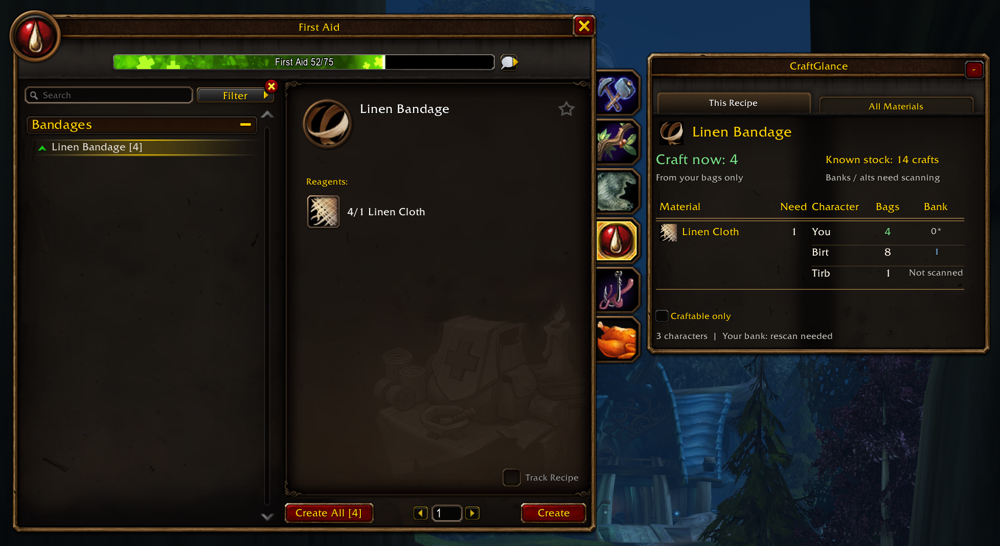
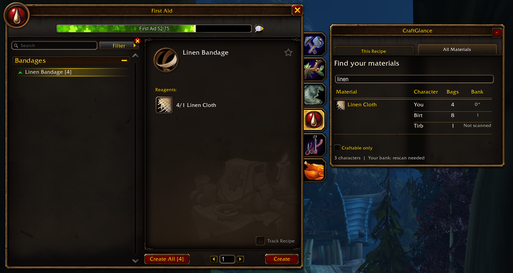
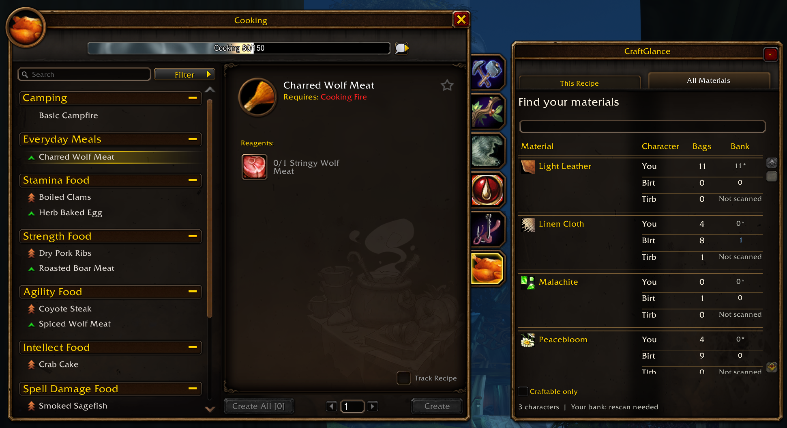

CraftGlance adds a compact material tracker beside your profession window in
**World of Warcraft Forever**. Select a recipe to see how many times you can
craft it and which characters have the ingredients.

- **Craft now** counts recipe executions using items in your current bags and
  any required currency you currently own.
- **Known stock** gives a planning count that includes eligible recorded bags
  and character banks across your alts.
- The **Material / Need / Character / Bags / Bank** table shows the full holding
  for each recorded character. **Need** is the quantity for one craft.
- Scanned zero holdings show **0 / 0**. **Not scanned** identifies an inventory
  whose contents are still unknown.
- A small **Missing** note shows what your bags lack for one craft. Hover a
  character for its full name and the observation time.
- **All Materials** searches recorded Crafting Reagents by name or exact item
  ID, including ingredients outside the selected recipe.
- The panel follows the profession window, fits short lists, scrolls longer
  lists and collapses to its title bar. Native brown-and-gold artwork, softer
  tabs and a fixed header edge keep both views consistent.
- **Craftable only** uses WoW's native recipe-list filter. CraftGlance's own item
  count uses bags only.

Open First Aid or another crafting profession and choose a recipe. Switch to
**All Materials** to search your recorded stock. `/cg` or `/craftglance` expands
the panel while the profession window is open.

Log in on each alt to record its bags, and visit its bank to record bank stock.
The addon saves observations locally for characters in the same region, realm
identity and faction. Saved quantities can change between observations. Guild
banks and shared account banks are outside this tracker.

A starred bank value, such as **0\*** or **11\***, is a retained observation after
a failed scan. Hover for its age. That bank needs a rescan, and its stale stock
is excluded from **Known stock** until a successful bank scan updates it. Last-observed bags on offline characters are also excluded when marked stale. Tools,
location requirements and cooldowns still apply to crafting.

Linen Bandage shows Craft now 4 and Known stock 14 beside the native profession
window. The bank value 0\* is a retained observation marked for rescan.

Searching `linen` narrows the stock list while keeping the full owner rows.

Longer material lists scroll within the attached panel. Light Leather Bank
11\* is retained as a last observation and excluded from Known stock until
rescanned.

**Compatibility** — World of Warcraft Forever **1.60.1**, interface **16001**.

**License** — Addon code and original project assets use the MIT license,
copyright 2026 Birt-tirb. The screenshots illustrate World of Warcraft's
interface. Blizzard artwork, fonts and other game assets remain the property
of their respective owners and are outside the project's MIT grant.

[Source code](https://github.com/Birt-tirb/CraftGlance/tree/craftglance-0.5.1)
and [bug reports](https://github.com/Birt-tirb/CraftGlance/issues).
